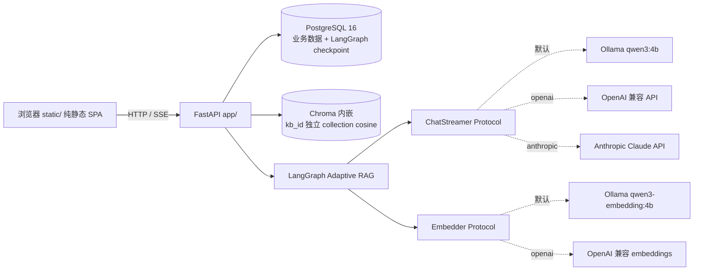
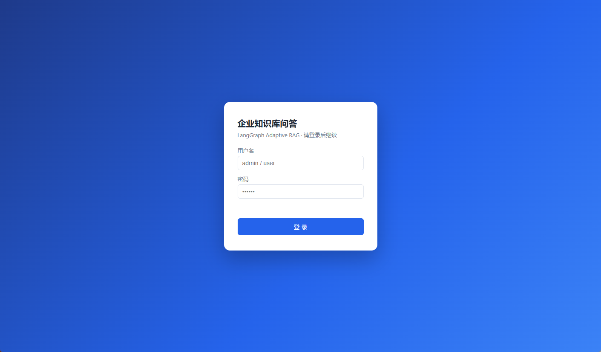
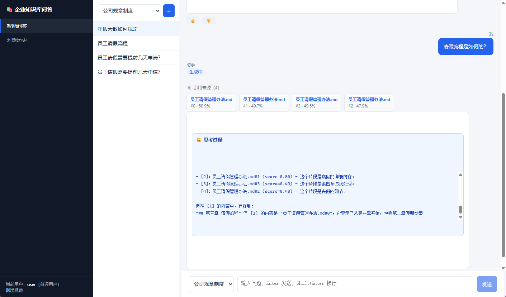
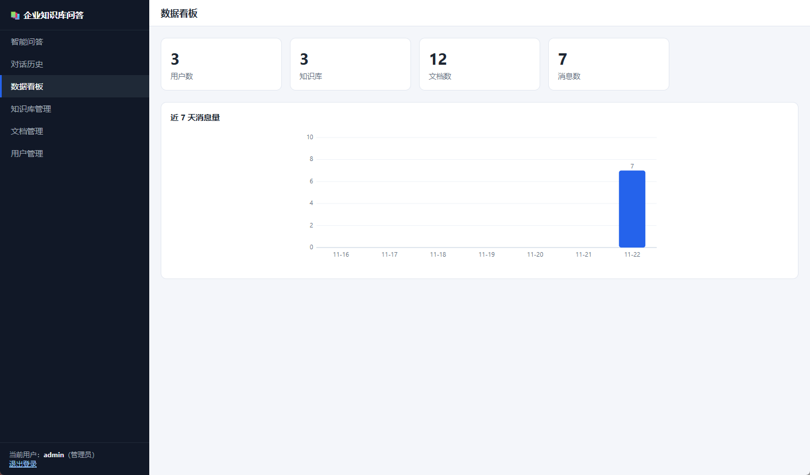
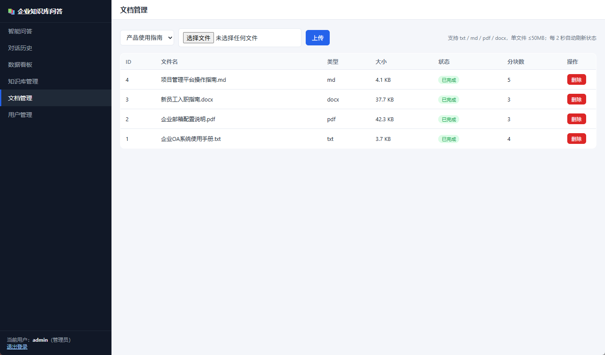

# langgraph_enterprise_assistant

企业级知识库问答系统 —— **LangGraph Adaptive RAG**。

知识库管理 → 文档异步入库 → 带权限的向量检索 → LangGraph 自适应问答（分类 / 评分 / 有限改写 / 拒答 / 引用校验）→ **SSE 真流式**输出 → 多会话 + 状态检查点 → 管理端看板。

## 架构



**Adaptive RAG 图**（`app/services/adaptive_rag/`）：

```text
START → normalize → classify
  clarification → abstain
  knowledge → retrieve → grade
    sufficient → generate(流式) → cite → validate → END
    不足且未达改写上限 → rewrite → retrieve（有界循环）
    不足且达上限 → abstain → cite → validate → END
generate 空答案 → abstain → cite → validate → END
```

**SSE 事件序**（`POST /api/chat/ask`，进流前完成权限校验）：

```text
node(可选进度) → sources → thinking×N → delta×N → done / error
```

图内 generate 通过 `stream + on_token` 逐块转发，**禁止整段生成后切片**；思考过程仅流式展示、不落库。

## 双通道模型配置

| 通道 | 变量 | 默认值（本地 Ollama，不得降级） | 可选值 |
|---|---|---|---|
| LLM | `LLM_PROVIDER` | `ollama` | `ollama` \| `openai` \| `anthropic` |
| LLM 模型 | `OLLAMA_LLM_MODEL` / `OPENAI_MODEL` / `ANTHROPIC_MODEL` | `qwen3:4b` | 按需 |
| Embedding | `EMBED_PROVIDER` | `ollama` | `ollama` \| `openai`（**无 anthropic**） |
| Embed 模型 | `OLLAMA_EMBED_MODEL` / `EMBED_MODEL` | `qwen3-embedding:4b` | 按需 |
| 上下文 | `OLLAMA_NUM_CTX` | `8192`（嵌入 4096） | **必须限制**，防 16GB 显存挤爆 |

- 缺 key **显式失败**，禁止静默降级（如 `LLM_PROVIDER=anthropic` 而 `ANTHROPIC_API_KEY` 为空 → 启动即报错）
- **Embedding 指纹**：索引写入 `embed_index_meta`，检索前校验当前 `Embedder.fingerprint`；不一致返回 **409 `embedding_mismatch`**
- 换 Embed 模型后唯一合法路径：`POST /api/knowledge-bases/{id}/reindex`（管理员）全量重建向量

完整变量见 [`.env.example`](.env.example)；设计细节见 [`docs/architecture.md`](docs/architecture.md)。

## 界面预览

| | |
|---|---|
|  |  |
|  |  |

## 快速开始

### 环境要求

- Python **3.12** + [uv](https://docs.astral.sh/uv/)
- Docker（PostgreSQL 16）
- [Ollama](https://ollama.com)（默认通道；需拉取 `qwen3:4b` 与 `qwen3-embedding:4b`）

### 启动

```bash
# 1. 依赖与环境
uv sync && uv run python --version        # 3.12.x

# 2. 数据库（含测试库初始化）
docker compose up -d db
uv run alembic upgrade head

# 3. 种子数据（admin/admin123、user/user123，3 库 12 文档并完成向量化）
uv run python scripts/seed.py

# 4. 启动服务（或 docker compose up -d api）
uv run uvicorn app.main:app --reload
# 打开 http://localhost:8000/
```

上传文档后状态机 `pending → processing → completed | failed`（管理端每 2 秒轮询）；失败会显示 `error_msg` 并可重传。

### 测试与评估

```bash
uv run ruff check .          # 0 error
uv run pytest -q             # 全部单测（不依赖 Ollama / 外网）

uv run python scripts/eval_rag.py   # 15 条 golden 检索评估 → eval_report.md
```

### 检索评估摘要

| 指标 | 结果 | 阈值 |
|---|---|---|
| Hit@1 | **1.0000** | — |
| Hit@4 | **1.0000** | ≥ 0.8 ✅ |
| MRR | **1.0000** | — |
| 平均检索延迟 | ~445 ms（本地 Ollama CPU/GPU 混跑） | — |

明细见 [`eval_report.md`](eval_report.md)（15 条覆盖公司规章制度 / 技术开发规范 / 产品使用指南三主题）。

## 权限模型

- JWT 登录（bcrypt cost 12）；**禁用用户（status=0）存量 token 立即 401**
- `admin`：全部资源；`user`：仅自己是成员的知识库与自己的会话/消息
- 所有 kb 相关读写**后端强校验**（非成员 403/404），非成员请求**进不了 SSE**

## 目录速览

```text
app/                 FastAPI（routes / services / models / core）
  services/adaptive_rag/   LangGraph 图、节点、prompt、stream_bridge
  services/llm/            ChatStreamer / Embedder 双通道工厂
static/              零依赖 hash SPA（无 npm / CDN / 构建）
alembic/             数据库迁移
scripts/             seed.py 种子、eval_rag.py 检索评估
tests/               pytest（权限 / 图节点 / SSE 顺序 / 四格式 / checkpoint）
docs/                plan.md、architecture.md、screenshots/
```

## License

[MIT](LICENSE)
